# LAPORAN PRAKTIKUM PEMROGRAMAN BERBASIS OBJEK

| Informasi Praktikan | Keterangan |
| :--- | :--- |
| **Nama** | Abang Kevin Husein |
| **NPM** | 4525210102 |
| **Kelas** | A |
| **Mata Kuliah** | Pemrograman Berbasis Objek (PBO) |
| **Pertemuan** | 10 - Exception Handling dan Pemrograman Defensif |
| **Tanggal** | Kamis 5 November 2026 |

---

## 1. Implementasi Java

### 1.1. File: `Main.java`

**Penjelasan Kode:**
> Main.Java Menampilkan menu interaktif (1. Tambah Buku, 2. Tambah Anggota, 3. Pinjam Buku, 0. Keluar) dalam perulangan while dan  aksi dengan switch. Setiap aksi diteruskan ke PerpustakaanService. Pilihan di luar 0-3 ditolak dengan peringatan. Setelah pengguna keluar, method eksporLaporan() menulis daftar buku ISBN, judul, stok, status Tersedia/Tidak Tersedia.

**Bukti Eksekusi (Screenshot):**
- **Before** 
- **After** 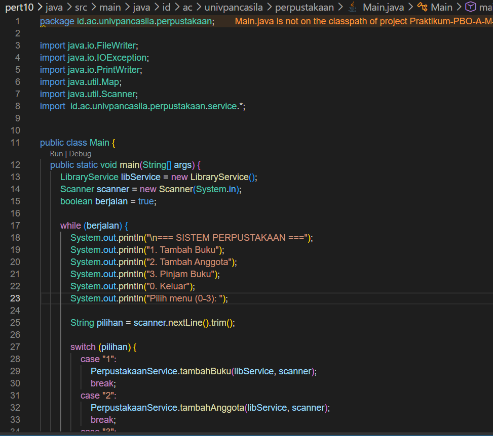

### 1.2. File: `AnggotaTidakDitemukanException.java`

**Penjelasan Kode:**
> Exception domain yang dilempar saat ID anggota belum terdaftar. Turunan PerpustakaanException dan membawa data idAnggota atribut private final beserta getter getIdAnggota(), sehingga pemanggil bisa mengambil ID penyebab error.

**Bukti Eksekusi (Screenshot):**
- **Before** 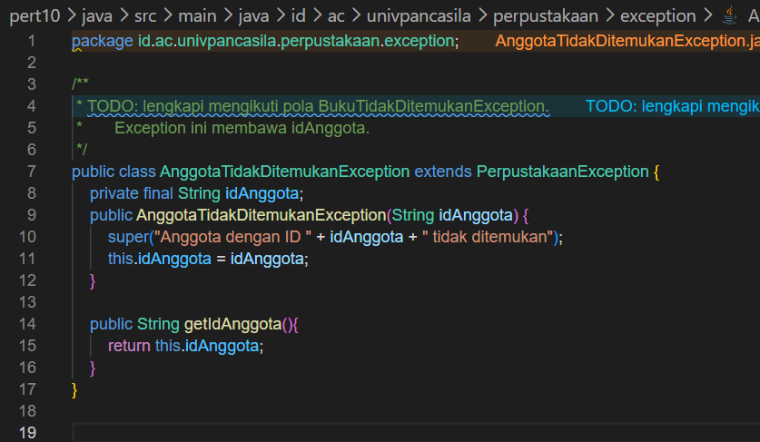
- **After** 

### 1.3. File: `BatasPinjamTerlampauiException.java`

**Penjelasan Kode:**
>Exception yang dilempar saat anggota sudah mencapai batas maksimum peminjaman. Membawa dua data, yaitu idAnggota dan batas, lengkap dengan getter-nya, sehingga pemanggil dapat menampilkan batas tanpa harus mengetahui aturannya sendiri.

**Bukti Eksekusi (Screenshot):**
- **Before** 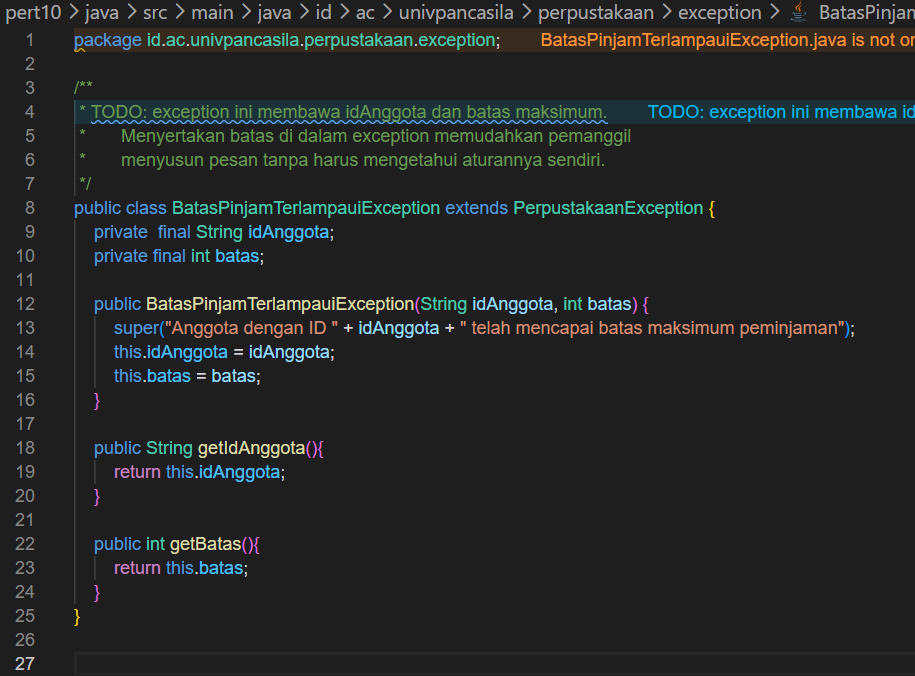
- **After** 

### 1.4. File: `BukuSedangDipinjamException.java`

**Penjelasan Kode:**
> Exception yang dilempar saat stok buku habis (semua eksemplar sedang dipinjam). Membawa isbn untuk diolah sistem dan judul agar pesan ke pengguna lebih bermakna, masing-masing dengan getter.

**Bukti Eksekusi (Screenshot):**
- **Before** 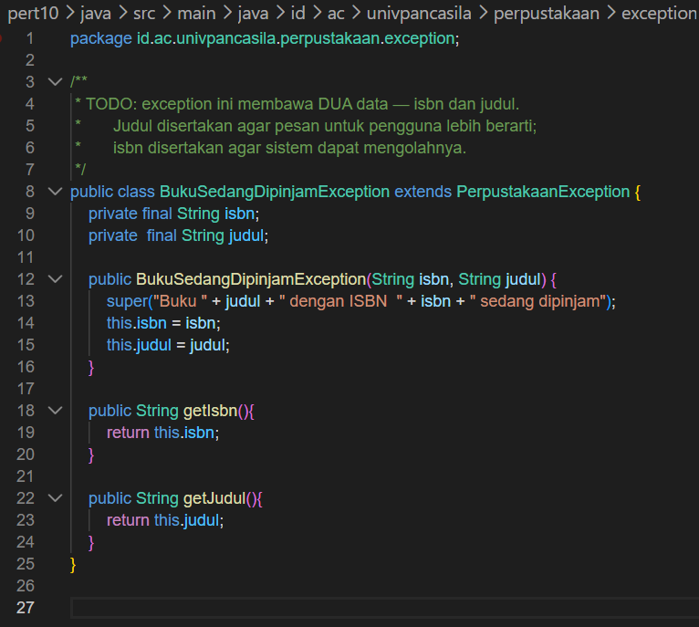
- **After** 

### 1.5. File: `BukuTidakDitemukanException.java`

**Penjelasan Kode:**
> Exception yang dilempar saat ISBN tidak ada di katalog. Membawa data isbn (bukan sekadar teks pesan) dan menyediakan getIsbn(), sehingga pemanggil bisa mengambil kembali penyebab error secara terstruktur.

**Bukti Eksekusi (Screenshot):**
- **Before** 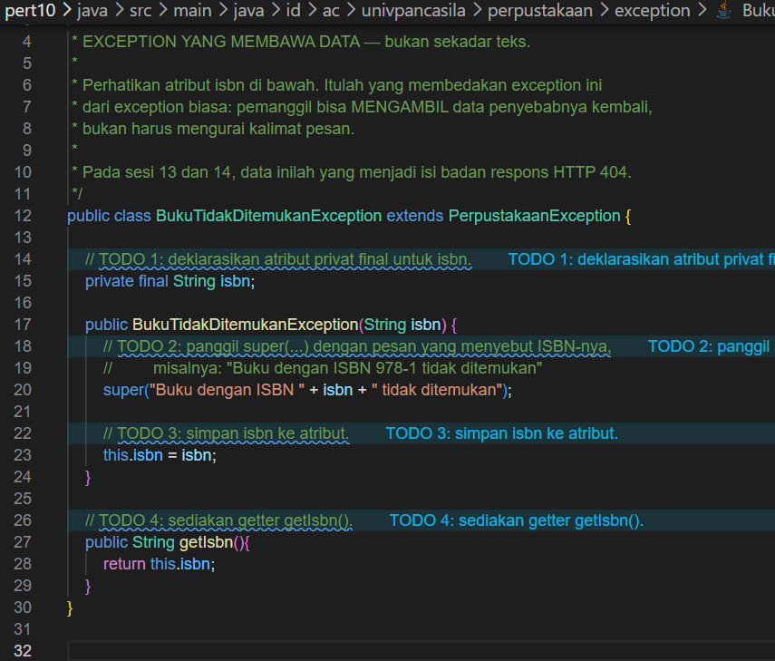
- **After** 

### 1.6. File: `PerpustakaanException.java`

**Penjelasan Kode:**
> Kelas induk abstract untuk seluruh exception domain perpustakaan, diturunkan dari RuntimeException (unchecked) karena kegagalannya  permintaan yang tidak sah, bukan kondisi luar yang wajar. Dengan induk bersama, semua kegagalan domain bisa ditangkap sekaligus lewat satu blok catch tanpa  kesalahan pemrograman lain.

**Bukti Eksekusi (Screenshot):**
- **Before** 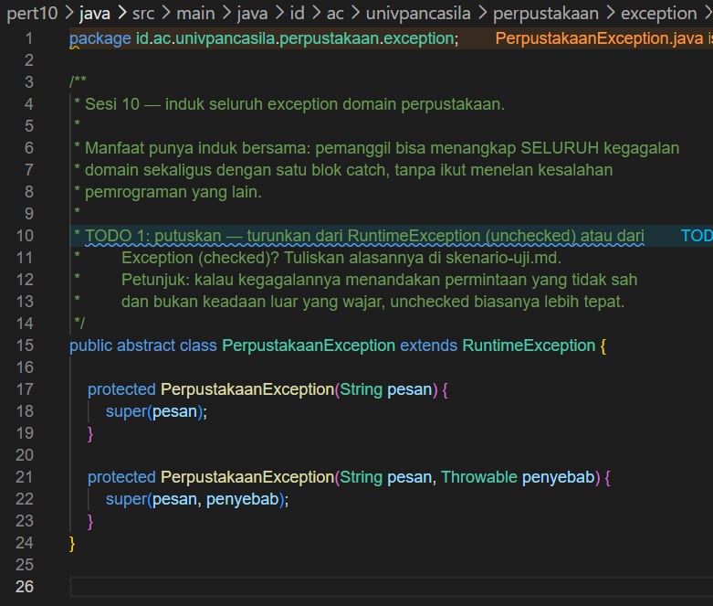
- **After** 

### 1.7. File: `LibraryService.java`

**Penjelasan Kode:**
> HashMap: stok, judul, dan pinjaman. Method pinjam() memakai guard clause: tiap syarat (anggota ada, buku ada, stok tersedia, batas pinjam belum tercapai) diperiksa berurutan dan langsung throw exception yang sesuai bila gagal. Alur utama (kurangi stok, tambah pinjaman) berada di akhir tanpa percabangan bersarang, dan pemanggil tahu alasan kegagalannya. Method pendukung: tambahBuku, daftarkanAnggota, sisaEksemplar, judulDari, getSemuaJudul.

**Bukti Eksekusi (Screenshot):**
- **Before** 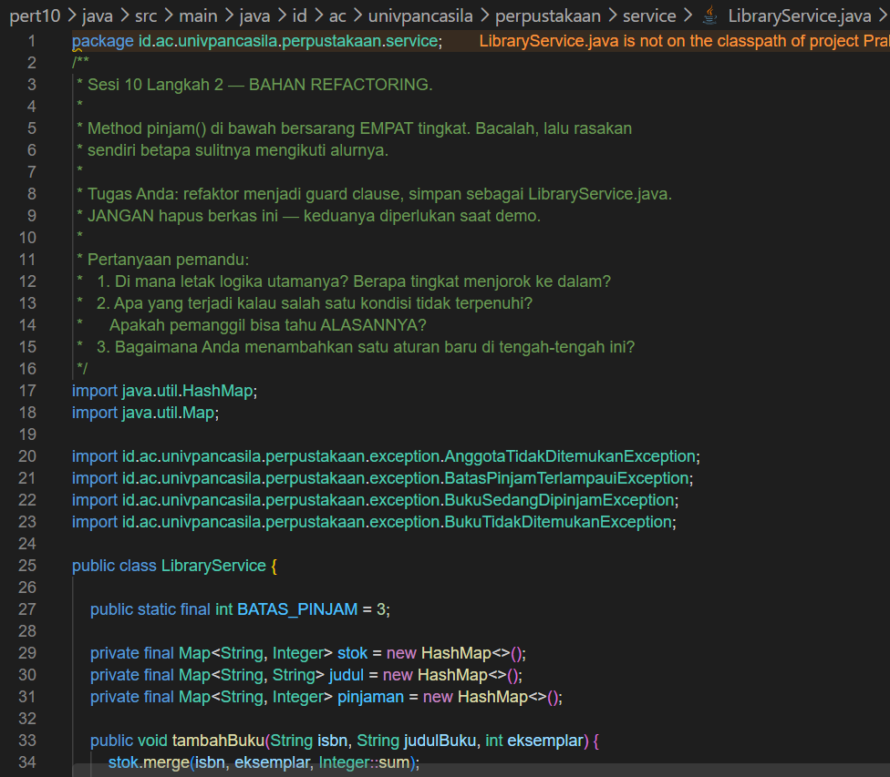
- **After** 

### 1.8. File: `LibraryServiceKotor.java`

**Penjelasan Kode:**
> Method pinjam() memakai if bersarang empat tingkat dan hanya mengembalikan true/false, sehingga pemanggil tidak tahu penyebab peminjaman gagal. Berkas ini dipertahankan sebagai pembanding dengan LibraryService.

**Bukti Eksekusi (Screenshot):**
- **Before** 
- **After** 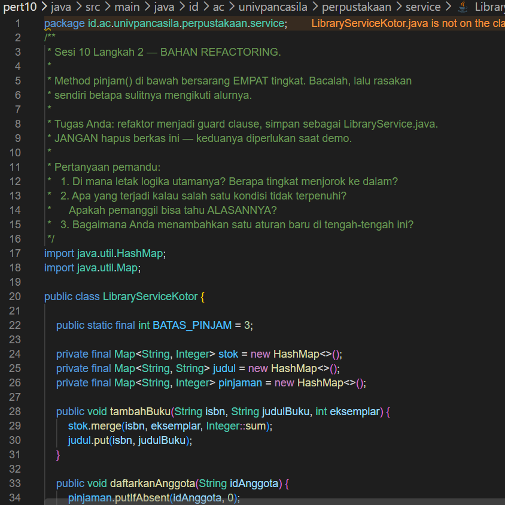

### 1.9. File: `PerpustakaanService.java`

**Penjelasan Kode:**
> Kelas penghubung antara input pengguna dan LibraryService, berisi tiga method statis. tambahAnggota memvalidasi ID tidak boleh kosong. tambahBuku memvalidasi ISBN dan jumlah eksemplar (harus angka dan lebih dari 0, NumberFormatException ditangkap). pinjamBuku berjalan dalam perulangan sampai pengguna mengetik exit; exception domain ditangkap lewat PerpustakaanException, lalu instanceof dipakai untuk menampilkan detail spesifik (ISBN, ID anggota, judul, atau batas). Exception umum ditangkap sebagai error sistem.

**Bukti Eksekusi (Screenshot):**
- **Before** 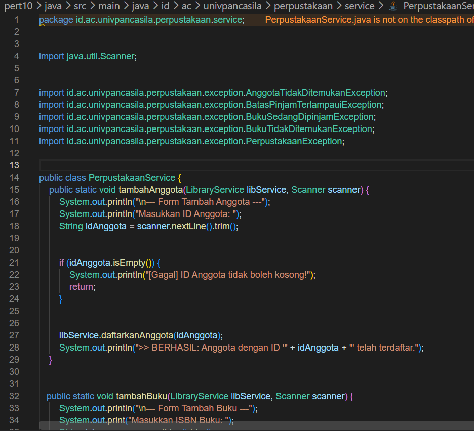
- **After** 

### Output

**Output Program:**

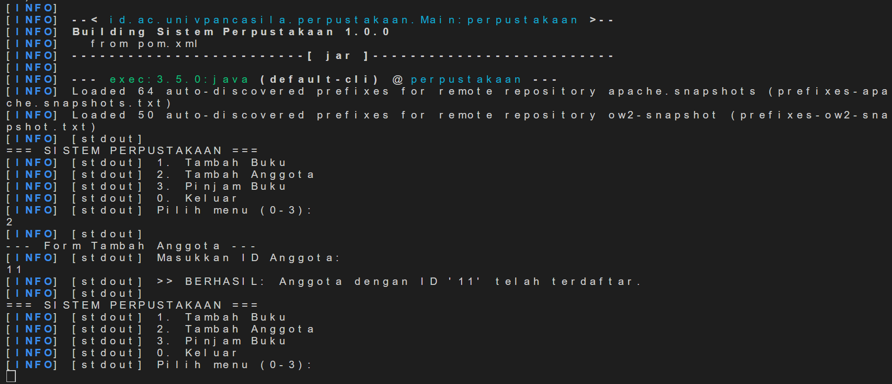
---

## 2. Implementasi PHP

### 2.1. File: `main.php`

**Penjelasan Kode:**
> Program utama PHP yang berfungsi sebagai demo. Memuat autoloader Composer, membuat objek LibraryService, mendaftarkan dua buku dan dua anggota, lalu menjalankan tujuh skenario peminjaman dalam foreach. Setiap skenario dibungkus try-catch untuk menangkap PerpustakaanException dan mencetak BERHASIL atau GAGAL beserta alasannya. Fungsi createReport() menulis laporan buku ke laporan_buku.txt memakai fopen/fwrite, dengan try-catch-finally agar file selalu ditutup lewat fclose meski terjadi error.

**Bukti Eksekusi (Screenshot):**
- **Before** 
- **After** 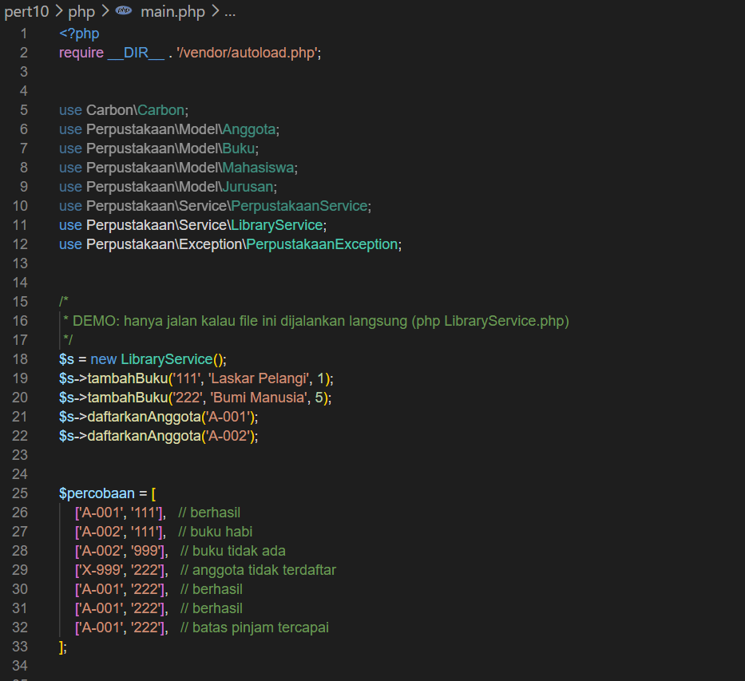

### 2.2. File: `AnggotaTidakDitemukanException.php`

**Penjelasan Kode:**
> Exception yang dilempar saat ID anggota tidak terdaftar. Berupa final class turunan PerpustakaanException dan memakai constructor property promotion (private readonly string $idAnggota) untuk menyimpan ID, dilengkapi getter getIdAnggota().

**Bukti Eksekusi (Screenshot):**
- **Before** 
- **After** 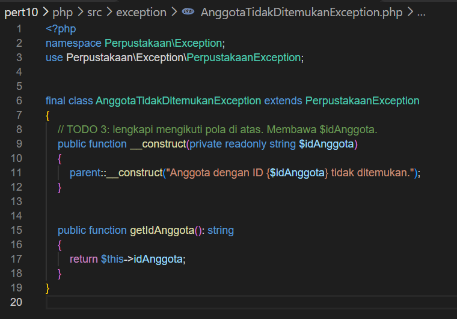

### 2.3. File: `BatasPinjamTerlampauiException.php`

**Penjelasan Kode:**
> Exception yang dilempar saat anggota sudah mencapai batas peminjaman. Membawa $idAnggota dan $batas sebagai properti readonly, dengan pesan yang menyebut ID dan batas buku, serta getter getIdAnggota() dan getBatas().

**Bukti Eksekusi (Screenshot):**
- **Before** 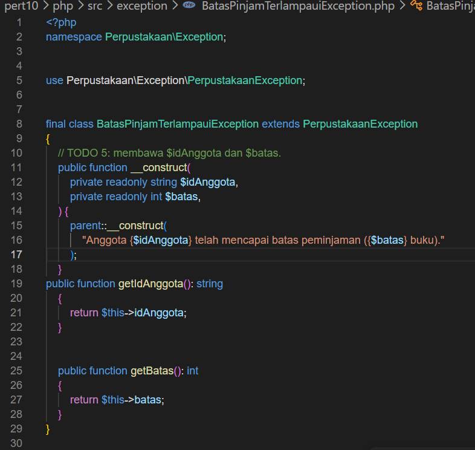
- **After** 

### 2.4. File: `BukuSedangDipinjamException.php`

**Penjelasan Kode:**
> Exception yang dilempar saat tidak ada eksemplar tersisa. Membawa $isbn dan $judul sebagai properti readonly agar pesan jelas dan data bisa diambil kembali lewat getIsbn() dan getJudul().

**Bukti Eksekusi (Screenshot):**
- **Before** 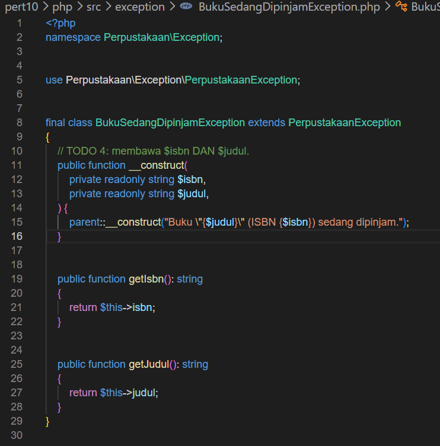
- **After** 

### 2.5. File: `BukuTidakDitemukanException.php`

**Penjelasan Kode:**
> Exception yang dilempar saat ISBN tidak ada di katalog. Menyimpan $isbn lewat constructor property promotion sebagai properti readonly, dengan getter getIsbn().

**Bukti Eksekusi (Screenshot):**
- **Before** 
- **After** 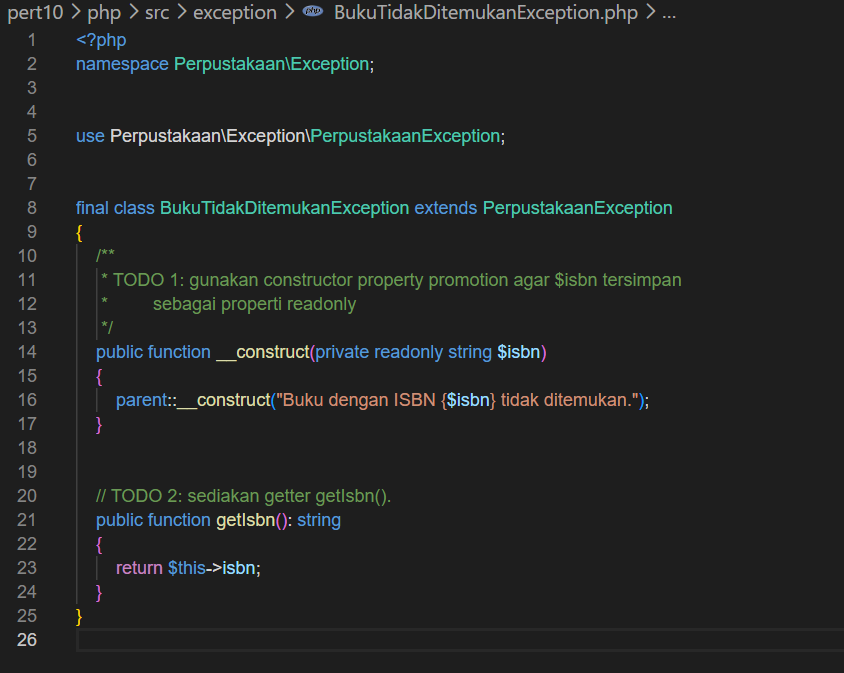

### 2.6. File: `PerpustakaanException.php`

**Penjelasan Kode:**
> bstract untuk semua exception domain PHP, diturunkan dari RuntimeException. Menjadi satu titik tangkap bersama untuk kegagalan domain. Karena PHP tidak punya checked exception, dokumentasi @throws pada PHPDoc menjadi penting bagi pembaca kode.

**Bukti Eksekusi (Screenshot):**
- **Before** 
- **After** 

### 2.7. File: `LibraryService.php`

**Penjelasan Kode:**
> Data disimpan dalam array $stok, $judul, dan $pinjaman, dengan konstanta BATAS_PINJAM = 3. Method pinjam() memakai guard clause yang melempar exception spesifik (anggota/buku tidak ditemukan, buku sedang dipinjam, batas terlampaui) dan didokumentasikan lewat @throws. Jika semua syarat lolos, stok dikurangi dan jumlah pinjaman anggota ditambah. Method lain: tambahBuku, daftarkanAnggota, sisaEksemplar, getSemuaJudul.

**Bukti Eksekusi (Screenshot):**
- **Before** 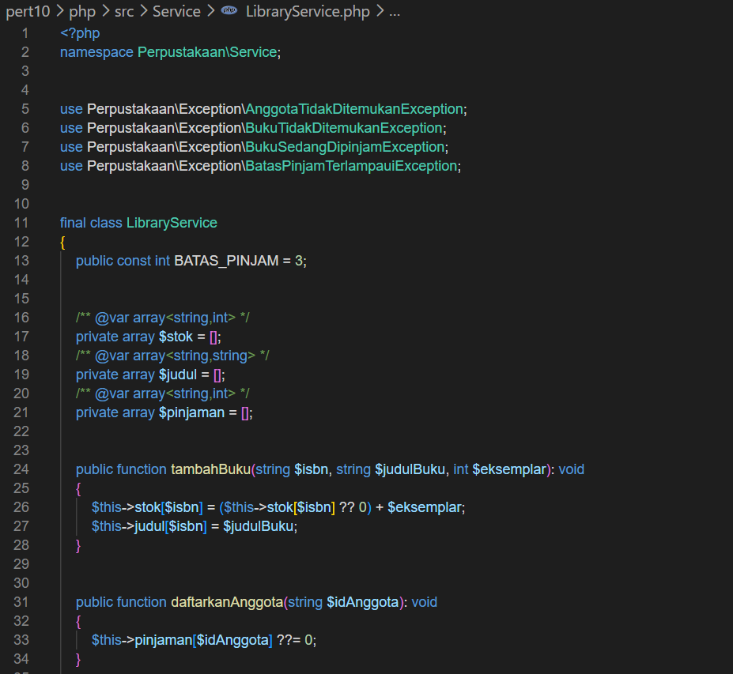
- **After** 

### 2.8. File: `LibraryServiceKotor.php`

**Penjelasan Kode:**
> Method pinjam() memakai if bersarang empat tingkat dan hanya mengembalikan true/false, sehingga penyebab kegagalan tidak diketahui pemanggil. Dipertahankan sebagai pembanding dengan LibraryService.php.

**Bukti Eksekusi (Screenshot):**
- **Before** 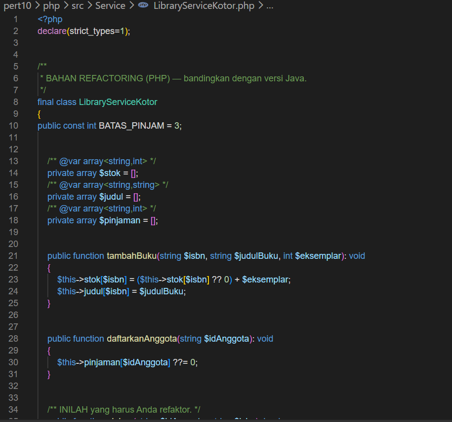
- **After** 

### 2.9. File: `PerpusatakanService.php`

**Penjelasan Kode:**
> Method tambahKoleksi() menambah buku, cariKoleksi() mencari buku berdasarkan nomor induk (mengembalikan null bila tidak ada), sedangkan pinjam() dan kembalikan() hanya mencetak pesan transaksi anggota.

**Bukti Eksekusi (Screenshot):**
- **Before** 
- **After** 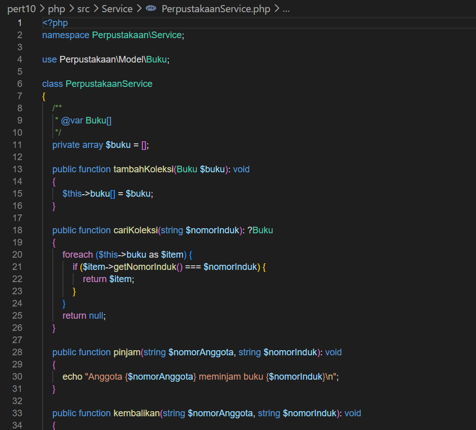

### Output

**Output Program:**

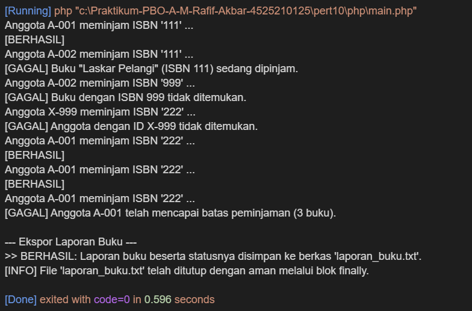

---

## 3. Kesimpulan

Exception handling membuat kegagalan program lebih jelas daripada sekadar mengembalikan true/false. Pada LibraryService, setiap kegagalan peminjaman dilempar sebagai exception khusus yang membawa data penyebabnya dan diturunkan dari satu induk, PerpustakaanException. Penggunaan guard clause membuat alur kode lebih rapi dibanding if bersarang. Validasi input, try-with-resources (Java), dan try-catch-finally (PHP) menjaga program tetap stabil saat terjadi kesalahan. Konsepnya sama di Java dan PHP, hanya sintaksnya yang berbeda.